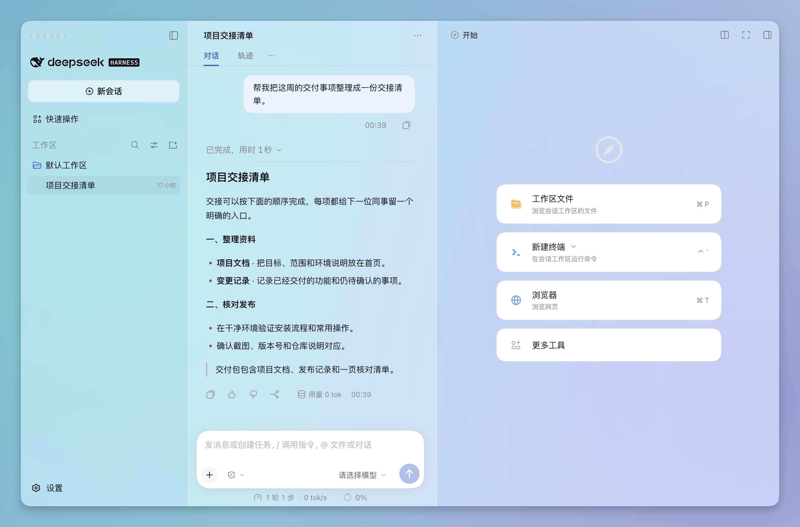
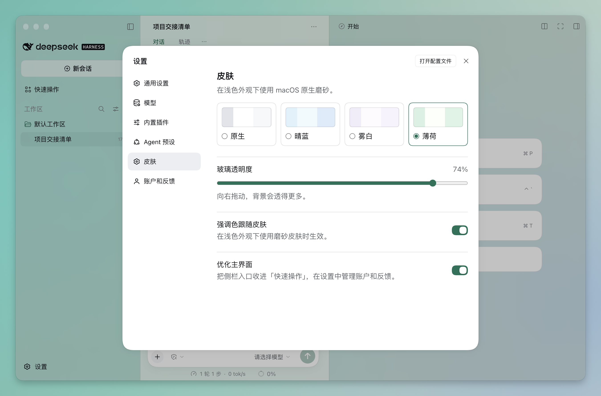

# DSH 原生磨砂皮肤

macOS 版 DeepSeek Harness 的三款磨砂皮肤，**晴蓝、雾白、薄荷**。玻璃背后是 macOS 合成的真实桌面和其他窗口。移动窗口时，透出的背景跟着变化，输入框和正文保持清楚。

入口在左下角 **设置 → 皮肤**。左栏的「皮肤」在「Agent 预设」下方。选中皮肤后可以拖动 **玻璃透明度**，范围 0%–85%，默认 60%。皮肤和透明度都保存在当前桌面配置中。

**强调色跟随皮肤** 默认开启。在浅色外观下，发送按钮、用户消息气泡、选中标签和链接等控件会随磨砂皮肤切换色系。关闭开关、选择「原生」或切到深色外观时，界面使用 DSH 原生配色。

浅色磨砂皮肤下，玻璃背景延伸到输入区两侧和用量栏，也覆盖审批、追问等卡片出现时的底部区域。消息的绘制边界随输入框或卡片的中线移动，滚到底时最后一条消息完整显示在输入区上方。

「皮肤」中的 **优化主界面** 默认开启。展开左栏后，「快速操作」汇集插件、自动化任务及同一侧栏区域的其他插件入口。登录和意见反馈可在 **设置 → 账户和反馈** 中打开。关闭开关后，侧栏即时恢复 DSH 原有入口，设置可从左下角的原生菜单打开。

## 界面预览

截图来自隔离 DSH 的演示会话，窗外的色彩来自窗口后方的背景。

**晴蓝 · 三栏工作区**



| 雾白 · 对话与输入区 | 薄荷 · 皮肤设置 |
| --- | --- |
|  |  |

## 适用范围

- macOS 版 DSH `0.2.2-rc.5`。
- GitHub 安装流程同时安装皮肤插件和 macOS 原生 HUD 桥接。没有已保存的皮肤偏好时，浅色外观默认使用「晴蓝」和 HUD 磨砂。
- 三款皮肤在浅色外观下生效。选「原生」或切到深色时，窗口恢复 DSH 默认材质。开启 macOS「降低透明度」时，皮肤使用实色底。升级保留已有的皮肤和透明度偏好。

## 从 GitHub 安装

先打开过一次主 DSH，以初始化桌面配置，然后退出使用同一个 App 的所有 DSH 实例。在 macOS 终端运行以下命令，需要 Node.js。

```sh
install_dir=$(mktemp -d)
archive="$install_dir/dsh-glass-skins-0.5.2.tgz"
curl -fL -o "$archive" \
  "https://github.com/thomaswade2000/dsh-glass-skins/releases/download/v0.5.2/dsh-glass-skins-0.5.2.tgz" &&
tar -xzf "$archive" -C "$install_dir" package/package.json package/scripts &&
node "$install_dir/package/scripts/install-desktop.mjs" "$archive"
```

安装器通过 DSH 随附的 CLI 安装到桌面配置，并在修改 App 前备份两个原始桌面文件。重新打开 DSH 即可使用。安装器默认使用 `/Applications/DeepSeek Harness.app`，也可以在安装包路径后传入实际的 App 路径。桥接支持已解包的应用布局，DSH 更新后需重新确认兼容性。

## 卸载

先退出 DSH，再使用安装包中的脚本恢复原始 App 文件，并从桌面配置移除皮肤插件。以下命令沿用安装时的 `install_dir`。

```sh
node "$install_dir/package/scripts/patch-desktop.mjs" remove "/Applications/DeepSeek Harness.app" &&
sh "/Applications/DeepSeek Harness.app/Contents/Resources/runtime/cli/bin/dsh" \
  plugin --profile desktop remove dsh-glass-skins
```

在仓库里开发时，运行 `npm test` 验证，运行 `npm pack` 生成包含安装器的发布包。

## 隐私

背景由 macOS 窗口合成器实时处理。桥接仅接收来自 DSH 主窗口主框架的布尔值，对应 HUD 和 Sidebar 两种系统材质。皮肤偏好使用当前桌面配置的本地存储。
